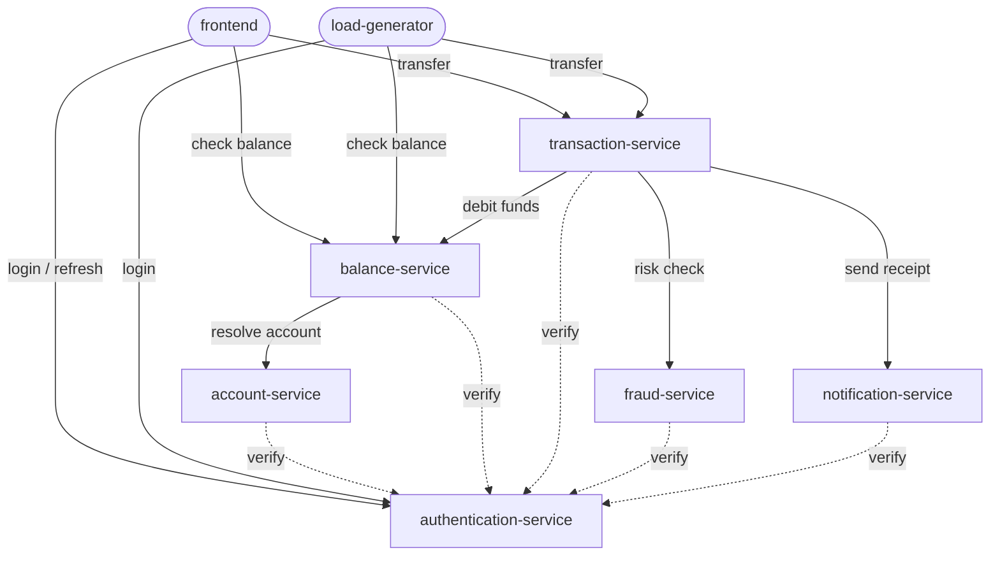
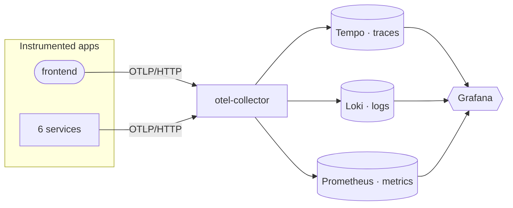

# OTel Tryout — a dummy bank

Six small microservices plus a browser frontend, all instrumented with
OpenTelemetry. One user action produces a single distributed trace that spans
the browser and every service it touches. Traces, logs, and metrics all flow
into a Grafana LGTM stack.

## Services

| Service                  | Port | Responsibility                                        |
| ------------------------ | ---- | ----------------------------------------------------- |
| `authentication-service` | 4001 | Issues tokens on login; validates them                |
| `account-service`        | 4002 | Resolves account details; validates the token via auth|
| `balance-service`        | 4003 | Returns a balance; resolves the account first         |
| `transaction-service`    | 4004 | Orchestrates a transfer (fraud → balance → notify)    |
| `fraud-service`          | 4005 | Risk-scores a transfer, approves or denies            |
| `notification-service`   | 4006 | Sends a receipt after a transfer                      |
| `load-generator`         | 4007 | Drives the flows continuously; HTTP-controlled        |
| `frontend`               | 5173 | Browser console with real OTel RUM                    |

## How the services connect

Solid edges are business calls; dashed edges are token verification
(each service verifies the JWT and checks revocation with auth — see
[Authentication](#authentication--authorization)).



A transfer is the deepest call chain:

```
frontend → transaction → fraud
                       → balance → account → authentication
                       → notification
```

## Observability pipeline

Every service and the browser ship OTLP to a gateway collector (CORS enabled
so the browser can post directly). The collector forwards to the bundled LGTM
stack.



- **Tempo** — traces. One trace per click, nested across all services.
- **Loki** — logs, each carrying the `trace_id` of its request.
- **Prometheus** — metrics: HTTP rate/latency from auto-instrumentation, plus
  custom counters (`auth_logins_total`, `transfers_total`, `fraud_checks_total`, …).

## Authentication & authorization

Token model is **signed JWT with introspection on the side** (a hybrid):

- **Login** (`POST /login`) checks a username/password against an in-memory user
  table (passwords hashed with scrypt) and returns a short-lived access JWT
  (15 min, HS256, with `sub`/`scope`/`exp`/`jti`) plus a refresh token.
- **Every service** verifies the JWT locally in shared `requireAuth` middleware —
  signature, issuer, audience, and expiry. No network hop on the hot path.
- **Revocation** is handled by introspection: the middleware calls auth's
  `POST /introspect` to confirm the token hasn't been revoked. Results are cached
  per token for 15s. Money moves (`/transfer`) force a live check every time
  (`introspect: "always"`); reads use the cache.
- **Authorization** is scope-based. The JWT carries scopes; routes demand one
  (`account:read`, `balance:read`, `balance:write`, `transfer`). A missing scope
  returns `403`.
- **Refresh** (`POST /refresh`) rotates the refresh token and issues a new access
  token. **Logout** (`POST /logout`) revokes the access token's `jti` and its
  refresh token.

Demo users:

| Username | Password      | Scopes                                               |
| -------- | ------------- | ---------------------------------------------------- |
| ricardo  | `password123` | account:read, balance:read, balance:write, transfer  |
| viewer   | `viewer123`   | account:read, balance:read (transfer → 403)          |

The secret and issuer/audience come from `JWT_SECRET` / `JWT_ISSUER` /
`JWT_AUDIENCE` env vars (dev defaults are baked in). In production these would be
real secrets, the access token would be RS256 with a rotated key, and the user
table and revocation list would live in a datastore, not process memory.

## Running it

Requires Docker, Node 22+.

```bash
# 1. Observability stack (Grafana on :3000)
npm run stack:up

# 2. All six services (one terminal)
npm run services

# 3. Frontend (another terminal)
npm run frontend
```

Then open:

- Frontend: http://localhost:5173
- Grafana: http://localhost:3000 (anonymous, no login)
- Dashboard: http://localhost:3000/d/otel-tryout-bank

Stop the stack with `npm run stack:down`.

## Simulating an outage

The frontend has a checkbox per service. Ticking one sends an `x-fail-<service>`
header; that service returns `500`, and the failure surfaces in any service that
depends on it. Watch the **System status** tile on the dashboard flip to
`OUTAGE`, the per-service error-% tiles go red, and the failed request show up as
a red trace in Tempo.

| Toggle            | Header                 | What fails                               |
| ----------------- | ---------------------- | ---------------------------------------- |
| Fail login        | `x-fail-login`         | auth login (no token issued → cascades)  |
| Fail account      | `x-fail-account`       | account (and balance/transaction above it) |
| Fail balance      | `x-fail-balance`       | balance (and transaction above it)       |
| Fail transaction  | `x-fail-transaction`   | transaction                              |
| Fail fraud        | `x-fail-fraud`         | fraud (and transaction above it)         |
| Fail notification | `x-fail-notification`  | notification                             |

The console has **one** set of outage switches (the "Service outages" card), one
per service. A switch applies to *both* the manual buttons and the generated
traffic — the service returns 500 for every request that touches it while the
switch is on. The state is held by the load-generator and shared by everything,
so it's also settable via its control API (see below).

## Generating continuous load

The `load-generator` service runs the flows (login → balance → transfer) on a
loop, server-side, so traces/logs/metrics keep flowing with no browser open. It
holds its state in-process and exposes a control API — the frontend's Load
generator panel drives it, and so can curl:

```bash
# status
curl -s localhost:4007/control

# start at a faster rate
curl -s -X POST localhost:4007/control -H 'Content-Type: application/json' \
  -d '{"running":true,"intervalMs":400}'

# take the fraud service down on generated traffic
curl -s -X POST localhost:4007/control -H 'Content-Type: application/json' \
  -d '{"faults":{"fraud":true}}'

# stop
curl -s -X POST localhost:4007/control -H 'Content-Type: application/json' -d '{"running":false}'
```

## Dashboard as code

The dashboard lives at `grafana/dashboard.json`. After editing it, re-push:

```bash
node -e "const fs=require('fs');const d=JSON.parse(fs.readFileSync('grafana/dashboard.json','utf8'));fs.writeFileSync('/tmp/dash.json',JSON.stringify({dashboard:d,overwrite:true}))"
curl -s -X POST http://localhost:3000/api/dashboards/db -H 'Content-Type: application/json' --data @/tmp/dash.json
```
